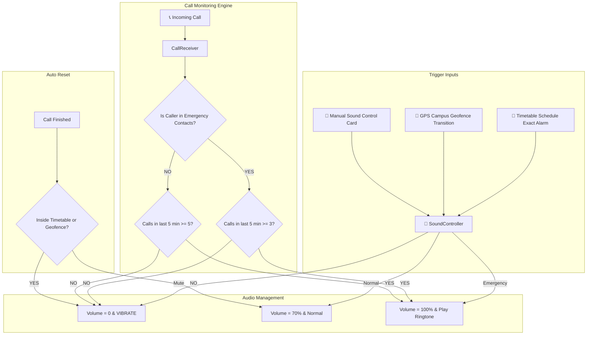

# 🔕 Auto Silent Pro

[](https://github.com/dharanikumarj16-code/auto-Silent-application/actions)


> **Smart College & School Sound Controller** featuring Automated Timetable Scheduling, GPS Campus Geofencing, and an Intelligent 5-Minute Emergency Call Bypass Engine.

---

## 📲 Direct APK Download

You can download and install the application directly on your Android phone without needing Android Studio:

👉 **[Download AutoSilentPro.apk](apk/AutoSilentPro.apk)** *(Ready to install)*

---

## 🚀 Key Features

### 1. 📅 Automated College / School Timetable
* Set your class start time and end time (e.g., 09:00 AM – 04:30 PM).
* Automatically switches phone to **Silent Mode** during class hours.
* Restores phone to **Normal Mode** when class ends.
* **Exact Daily Rescheduling**: Automatically repeats every day and restores after phone reboots (`BootReceiver`).
* **Real-Time Check**: If you save your schedule while currently in class, the phone silences **immediately**.

### 2. 📍 GPS Campus Geofencing
* Integrated with **Google Play Services Location & Geofencing API**.
* One-tap GPS acquisition: Tap *"🎯 Get My Current GPS Location"* to auto-fill campus coordinates.
* Configurable radius (e.g., 200m or 500m).
* **Automatic Geofence Transitions**:
  * 🚶➡️🏫 **Entering Campus**: Phone automatically switches to **Silent Mode**.
  * 🏫➡️🚶 **Leaving Campus**: Phone automatically restores to **Normal Sound Mode**.

### 3. 🚨 5-Minute Emergency Call Bypass Engine
Never miss urgent emergency calls while maintaining silence in class:
* **👨‍👩‍👧 Emergency Family Contacts (Father, Mother, Sister, Guardian)**:
  * If any contact in your emergency list calls **3 times within 5 minutes** $\rightarrow$ 🚨 **Emergency Triggered!** The app overrides Silent Mode, increases ring volume to **100% (MAX)**, and rings loud.
* **📞 Unknown / Other Callers**:
  * If an unknown number calls **5 or more times within 5 minutes** $\rightarrow$ 🚨 Detected as a critical crisis, the app overrides Silent Mode and rings loud.
* **🔄 Auto-Revert to Silent**:
  * As soon as the call ends, if you are still within college hours or campus geofence, the app automatically puts your phone back into **Silent Mode**.

### 4. 🔕 Zero-Volume Silent Engine
* Eliminates Xiaomi / MIUI / OEM audio policy conflicts by setting hardware volume streams (`STREAM_RING` and `STREAM_NOTIFICATION`) directly to `0`.
* Prevents the operating system from reverting silent mode back to normal sound in milliseconds.

### 5. 🧪 Embedded Viva & Demo Simulator
* Built-in interactive test controls at the bottom of the screen:
  * **⚡ Simulate 3rd Family Call**: Triggers the exact family emergency loud ring alert without needing extra phones.
  * **📞 Simulate 5th Unknown Call**: Simulates 5 repeated calls from an unknown caller.
  * **🛑 Reset to Silent Mode**: Instantly silences phone sound again.

---

## 🏛️ System Architecture



---

## 📥 How to Install on Your Android Device

1. **Download APK**: Download [AutoSilentPro.apk](apk/AutoSilentPro.apk) to your phone.
2. **Install**:
   * Open **File Manager** on your phone $\rightarrow$ Tap `AutoSilentPro.apk` $\rightarrow$ Tap **Install**.
   * If prompted by Android / MIUI, toggle on *"Allow from this source"*.
3. **Grant Required Permissions**:
   * **Do Not Disturb (DND) Access**: Required to mute/unmute system audio.
   * **Phone State & Call Log**: Required to detect incoming call frequency and match emergency contacts.
   * **Location (Allow all the time)**: Required for background GPS geofencing.

---

## 🧪 Running Unit Tests

To run the automated unit test suite locally:

```bash
./gradlew testDebugUnitTest
```

### Tested Scenarios (`AutoSilentUnitTest.kt`):
* `testPhoneNumberNormalization`: Standardizes country codes, spaces, and dashes to match 10-digit phone numbers.
* `testEmergencyContactMatching`: Verifies family contact matching vs. unknown numbers.
* `testEmergencyThresholdRules`: Validates 3-call threshold for family and 5-call threshold for unknown numbers.
* `testSlidingWindow5MinutePurge`: Verifies timestamps older than 300,000ms are expired.
* `testScheduleWindowCalculation`: Verifies active class timetable calculation and cross-midnight handling.

---

## 🐳 Docker Build (Headless Compilation)

To build the project and generate the APK using Docker:

```bash
# Build the Docker image (installs Android SDK 35 & compiles APK)
docker build -t auto-silent-app .

# Extract the APK from the container
docker run --rm -v ${PWD}:/output auto-silent-app
```

---

## 📁 Repository Structure

```text
├── apk/
│   └── AutoSilentPro.apk             # Ready-to-install standalone APK
├── app/
│   ├── build.gradle.kts              # App dependencies & SDK configuration
│   └── src/
│       ├── main/
│       │   ├── AndroidManifest.xml   # Permissions & Broadcast Receivers
│       │   ├── java/com/example/myapplication/
│       │   │   ├── MainActivity.kt               # Main UI, Timetable, Geofence & Simulator
│       │   │   ├── SoundController.kt            # Zero-volume hardware sound controller
│       │   │   ├── CallReceiver.kt               # 5-min sliding call tracking engine
│       │   │   ├── AlarmReceiver.kt              # Exact daily repeating timetable alarms
│       │   │   ├── BootReceiver.kt               # Auto-restore on phone restart
│       │   │   ├── GeofenceBroadcastReceiver.kt  # GPS campus perimeter transitions
│       │   │   └── EmergencyContact.kt           # Contact data model & JSON persistence
│       │   └── res/layout/
│       │       ├── activity_main.xml # Modern responsive user interface
│       │       └── item_contact.xml  # Dynamic emergency contact item row
│       └── test/
│           └── java/com/example/myapplication/
│               └── AutoSilentUnitTest.kt         # Comprehensive unit tests
├── .github/workflows/
│   └── build-and-test.yml            # Automated CI/CD GitHub Actions workflow
├── Dockerfile                        # Reproducible container build configuration
├── build.gradle.kts                  # Root Gradle build script
└── README.md                         # Project documentation
```

---

## 📄 License
This project is open-source and available under the [MIT License](LICENSE).
